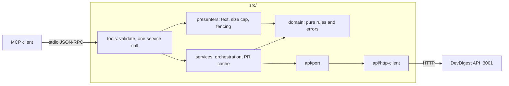

# DevDigest MCP server (`@devdigest/mcp`)

A stdio [Model Context Protocol](https://modelcontextprotocol.io) server that lets an MCP client
(Claude Code, MCP Inspector) use DevDigest. It is a thin adapter over the DevDigest HTTP API
(default `http://localhost:3001`). It has no database and no server imports, and it opens no port.
Spec: [../specs/L04-mcp-server.md](../specs/L04-mcp-server.md). Layering rules:
[AGENTS.md](AGENTS.md).

## Tools

All tools take a `repo` as `owner/name` (the repo must already be added in DevDigest). Schemas live
in [src/tools/schemas.ts](src/tools/schemas.ts).

| Tool | Input | What it does |
|------|-------|--------------|
| `list_agents` | none | Lists review agents with name, enabled flag, model and focus ([list-agents.ts:10](src/tools/list-agents.ts)). |
| `run_review` | `repo`, `pr_number`, `agent?` (name or id; omit = all enabled) | Starts an async review and returns `run_ids`. It spends LLM tokens ([run-review.ts:12](src/tools/run-review.ts)). |
| `get_findings` | `repo`, `pr_number`, `run_id?` (uuid; omit = latest review of each agent), `severity_min?` (`CRITICAL` / `WARNING` / `SUGGESTION`, default `SUGGESTION`), `limit?` (1-50, default 20), `offset?` (default 0), `response_format?` (`concise` / `detailed`, default `concise`) | Returns findings, or the status of a run that is still going ([get-findings.ts:14](src/tools/get-findings.ts)). |
| `get_conventions` | `repo`, `limit?` (1-100, default 30), `response_format?` | Returns extracted coding conventions. Read-only: it never starts an extraction ([get-conventions.ts:11](src/tools/get-conventions.ts)). |
| `get_blast_radius` | `repo`, `pr_number`, `file?` | Registered but not implemented: it always returns an error ([get-blast-radius.ts:8](src/tools/get-blast-radius.ts)). |

Typical flow, from the server instructions ([src/instructions.ts](src/instructions.ts)):
`list_agents` then `run_review` (async), then poll `get_findings` until the run is done.

Finding and convention text is model output about untrusted code. The server tells the client to
treat it as data, not instructions ([src/instructions.ts:4](src/instructions.ts)).

## Set up

```sh
cd mcp && npm install
./scripts/dev.sh        # from the repo root: Postgres + API on :3001 (the tools call this API)
```

### Environment variables

Both are read only in [src/config.ts](src/config.ts).

| Variable | Default | Notes |
|----------|---------|-------|
| `DEVDIGEST_API_URL` | `http://localhost:3001` | Must be an `http(s)` URL; trailing slashes are stripped ([config.ts:3](src/config.ts), [config.ts:37](src/config.ts)). |
| `DEVDIGEST_TIMEOUT_MS` | `15000` | Positive integer, milliseconds ([config.ts:4](src/config.ts), [config.ts:12](src/config.ts)). |

## Use it from Claude Code

The repo root has a project-scoped [`.mcp.json`](../.mcp.json) that registers a `devdigest` server.
It runs `npm --prefix mcp run --silent start` and passes `DEVDIGEST_API_URL`
(`${DEVDIGEST_API_URL:-http://localhost:3001}`).

1. Start the API with `./scripts/dev.sh`.
2. Open Claude Code in the repo root and approve the project MCP server when prompted.
3. Run `/mcp`. `devdigest` should be listed as connected.
4. Run `/context` to see what the MCP tools cost in your context window.

With Tool Search, Claude Code loads only tool names and the server instructions at startup. The full
schemas load when a tool is needed. The size budget is enforced by
[test/guards/tools-list.test.ts:61](test/guards/tools-list.test.ts): instructions at most 600
characters, each tool description at most 350, and the whole `tools/list` JSON at most 7000. Run
`npx vitest run test/guards/tools-list.test.ts --reporter=verbose` to print the current numbers
(at 2026-10-13: instructions 485, longest description 218, `tools/list` 4,433 characters — about
1.1k tokens).

## Try it with MCP Inspector

```sh
cd mcp && npm run inspect
```

Or call the registered server from the CLI, from the repo root:

```sh
npx @modelcontextprotocol/inspector --cli --config .mcp.json --server devdigest --method tools/list
```

## Architecture



Only `src/create-server.ts` constructs the HTTP client. The layer table and dependency rule are in
[AGENTS.md](AGENTS.md); `test/guards/layering.test.ts` enforces them.

## Tests

```sh
npm run typecheck && npm test   # hermetic: unit, in-memory MCP client, guards
npm run test:it                 # smoke test against the real API (needs ./scripts/dev.sh)
```

CI runs the hermetic suite in the `mcp.yml` workflow. See [../TESTING.md](../TESTING.md).

## Troubleshooting

- **Never write to stdout.** It carries JSON-RPC. Logs go to stderr as JSON lines via
  [src/log.ts](src/log.ts); there is no `console.log`.
- **"DevDigest API unreachable at ..."**: the API is down or the URL is wrong. Start it with
  `./scripts/dev.sh` or set `DEVDIGEST_API_URL` ([src/tools/tool-result.ts:44](src/tools/tool-result.ts)).
- **Unexpanded `${DEVDIGEST_API_URL:-...}`**: only Claude Code expands this syntax from `.mcp.json`.
  `loadConfig` treats an unexpanded `${...}` value as unset and uses the default
  ([src/config.ts:20](src/config.ts)).
- **`get_blast_radius` returns an error**: expected, it is not implemented yet. Use `get_findings`.
